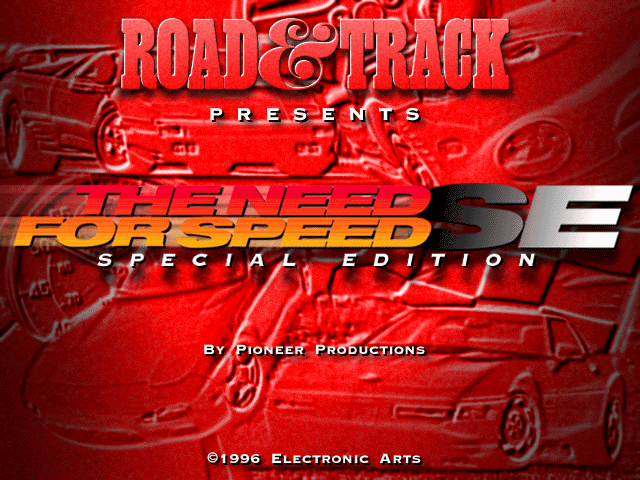
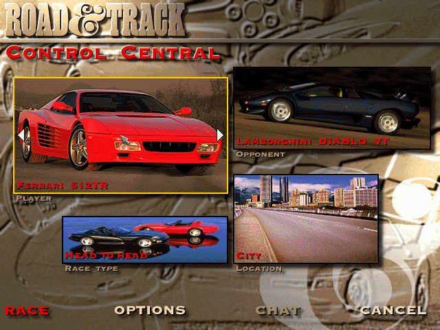
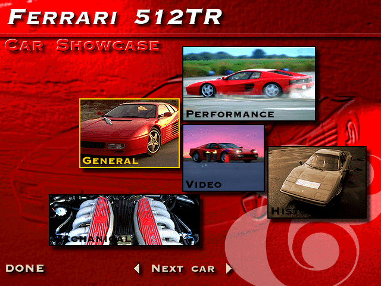
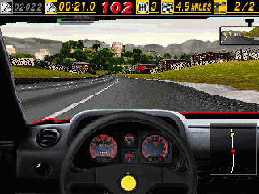
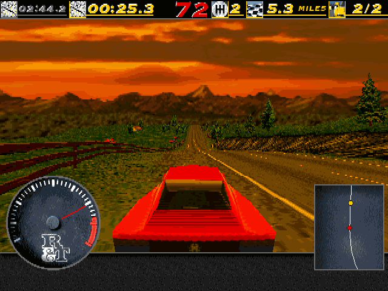
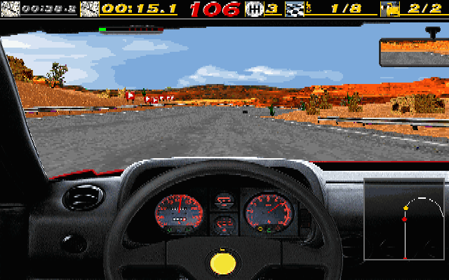
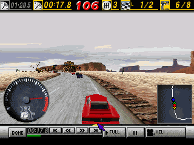

# ReNFS

*The Need for Speed Special Edition* (Electronic Arts Canada, 1996, MS-DOS), written again
for **Linux, Windows and macOS** by reading the original program. A MiSTer version is next.

The whole single-player game is in: every car and track, head to head, single race, time
trial, tournaments, the rally, the police, the traffic, replays and highlights, the cars'
showcase with its films, the records, saved tournaments, the original's typed codes, its
music and speech, English and German. Races run at 640x480 or 320x200, as the original's
two settings, and smoothly at 60 frames a second. Keyboard, game pad, joystick and mouse;
a pad rumbles and a force-feedback wheel gets the original's effects.

Not in it: the network and modem race (greyed out in the menu).



| | |
|---|---|
|  |  |
|  |  |
|  |  |

On the MiSTer, races can also be 320x240, 640x240 and 640x200, made for 15 kHz screens:

| | |
|---|---|
|  |  |
|  |  |

**Beta**: the latest version is on the
[releases page](https://github.com/ItsDanik/ReNFS/releases). Please report problems on the
[issues page](https://github.com/ItsDanik/ReNFS/issues).

## You need the game's CD

ReNFS contains no part of the game: it reads the files of your own copy of *The Need for
Speed SE* CD, as they are.

1. Download ReNFS for your system (below) and unpack it.
2. Copy **everything on the CD** (or in an image of it) into a folder named **`NFSSE`**
   next to the program:

   ```
   renfs                      (renfs.exe on Windows, ReNFS.app on macOS)
   NFSSE/NFS_DOS.EXE
   NFSSE/FRONTEND/...
   NFSSE/GAMEDATA/...
   NFSSE/SIMDATA/...
   ```

   Or keep the files anywhere and start the program with `-data <that folder>`. Upper or
   lower case in the names does not matter. Nothing has to be installed or unpacked.
3. Start the program. If the files are not found, a message says what is missing.

It needs the **Special Edition** CD (the DOS program `NFS_DOS.EXE` on it); the first
*Need for Speed* CD of 1995 is a different program.

## Download

Built programs are on the [releases page](https://github.com/ItsDanik/ReNFS/releases):

- **Windows** (10 or 11, 64-bit): `renfs-<version>-windows-x86_64.zip`. Unpack it, put
  the `NFSSE` folder next to `renfs.exe`, double-click `renfs.exe`.
- **Linux** (x86-64): `renfs-<version>-linux-x86_64.tar.gz`. It needs SDL2, which most
  systems have (`sudo apt install libsdl2-2.0-0` on Debian, Ubuntu and Mint, `sudo dnf
  install SDL2` on Fedora, `sudo pacman -S sdl2` on Arch). Unpack it, put the `NFSSE`
  folder next to `renfs`, run `./renfs`.
- **macOS** (10.13 or later, Apple silicon or Intel): `renfs-<version>-macos.zip`. Unpack
  it, move `ReNFS.app` out of Downloads (to Applications or a folder of your own), put the
  `NFSSE` folder next to it (or in `~/Library/Application Support/renfs/`), double-click
  `ReNFS.app`. It is not signed by Apple: the first time, macOS refuses it; open it with
  System Settings → Privacy & Security → *Open Anyway* (on macOS 14 and older: right-click
  → Open), or run `xattr -dr com.apple.quarantine ReNFS.app` once.

## Playing

The menus work with the mouse, or the arrows, Enter and Esc. **Alt+Enter** switches between
a window and the whole screen (on a Mac Option+Return or Cmd+Return; F1..F11 may need fn,
End is fn+→).

**Driving** (as the original; every key can be changed in Options → Controls):

| Key | |
|---|---|
| ← → | steer |
| ↑ ↓ | accelerate, brake |
| A, Z | gear up, gear down (the automatic starts in neutral: one gear up to drive) |
| Space | handbrake |
| H | horn |
| C | next camera |
| M | the map |

**During a race:**

| Key | |
|---|---|
| Esc | the pause menu (continue, replay, options, quit) |
| P | pause; P again goes on |
| F1 | the view's size (from outside) |
| F2 | the picture's detail |
| F3 | how far the road is drawn |
| F4 | the sky |
| F5 | sound on or off |
| F6 | the markers over the other racers |
| F7, F8 | the bar at the top: shown or not, which figures |
| F9 | the view from the bumper instead of the cockpit |
| F11 | smooth motion on or off (below) |
| Shift+End | give up the race |
| Ctrl+Alt+1..8 | watch another car |

**A game pad** is found when the game starts; the first time, the original's calibration
screen appears (move the stick round its corners, let go, press a button; Esc skips it).
Options → Controls → Calibrate joystick does it again.

| Pad | |
|---|---|
| Left stick (or the d-pad) | steer; the menus' arrows |
| Right / left trigger | accelerate / brake |
| Right / left shoulder | gear up / down |
| A | horn; Space in the menus |
| B | the map; Enter in the menus |
| X | next camera |
| Y | handbrake |
| Start | Esc: the pause menu, back in the menus |

**For analogue steering, accelerator and brake, choose Joystick in Options → Controls**
(Steering "Joystick Left/Right", Accelerate/brake "Joystick Up/Down"), as in the original.
With the controls left on Keyboard the pad still drives, but all or nothing, like keys.
The mouse can steer too (Controls: Mouse): move it left and right, its buttons accelerate
and brake.

**Typed codes**: the original's codes work, typed in Control Central (the main menu).

### Smooth motion

The original moves the cars 33 times a second. ReNFS draws the race at every refresh of
the screen (60 times a second at 640x480, 70 at 320x200) with the cars and the camera
between those moves, so the motion is smooth. The race itself is the original's: the same
steps, the same physics, the same replays. **F11** switches it off and on.

Races are at 640x480 by default, as the original's own setting; Options → Graphics → the
first row gives 320x200.

### Rumble and force feedback

The original could drive a force-feedback wheel. ReNFS sends the same effects to what you
have: a pad rumbles (hits, walls and crashes on the strong motor, the road's surface and
speed on the weak one), and a wheel or stick with force feedback gets the kicks, the road's
shaking and the steady pull of the car's forces.

### Settings and saves

They go to `~/.config/renfs` on Linux, `%APPDATA%\renfs` on Windows and
`~/Library/Application Support/renfs` on macOS (or `-home
<folder>`), never into the game's folder: the game's settings and records, saved
tournaments (`<name>.sav`), replays, the joystick's calibration, and `renfs.cfg`, ReNFS's
own settings:

```
smooth 1            smooth motion (F11); 0 as the original
fullscreen 0        1 the whole screen (Alt+Enter)
forcefeedback 100   the strength of rumble and force feedback, 0 to 100; 0 none
```

### Language

English, as the CD starts. For German start it with `-lang de` (the CD holds both; on
Windows, a shortcut to `renfs.exe` with `-lang de` after it; on macOS `open ReNFS.app --args
-lang de` in Terminal).

## Building from source

SDL2 (the development package), CMake and a C compiler (on macOS: Xcode's command line
tools and `brew install sdl2 cmake pkg-config`):

```sh
cmake -S port -B port/build && cmake --build port/build
port/build/renfs -data <the CD's folder>
```

`renfs --help` lists the options. `tools/release_linux.sh`, `tools/release_windows.sh` and
`tools/release_macos.sh` make the release packages (a Debian 11 container, MinGW-w64, and
on a Mac a universal `ReNFS.app` with SDL2 inside).

## How it was made

ReNFS is not an emulator and not a machine translation: the original program was taken
apart (Ghidra, with the tools in `tools/`), and each routine written again by hand in C.
The game's fixed tables are read from the player's own `NFS_DOS.EXE` at run time, so
nothing of the game is in this repository. The races, the physics, the computer's
drivers, the drawing, the dashboard, the sounds and the force feedback were checked
against the original's own code, run in an emulator beside the port's, until they agree
to the bit; the CD's four replays play back exactly as recorded.

`docs/NOTES.md` is the full record (the program's map, the file formats, each routine and
how it was checked), `docs/HANDOVER.md` where the work stands, `CLAUDE.md` the summary
and the switches for testing.

## Licence

GPL-3.0 (`LICENSE`). *The Need for Speed* is a trademark of Electronic Arts; ReNFS is not
connected with Electronic Arts, and the game itself remains theirs.
